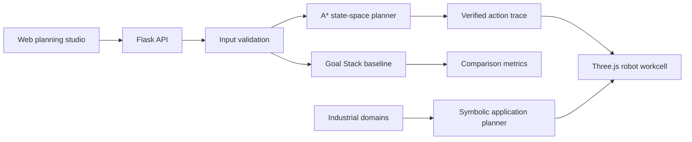

# Blocks World Planning and Industrial Robot Simulation

## Problem statement

The project plans legal manipulations of stacked blocks and translates the resulting symbolic actions into articulated robot motion. The production planner must avoid unnecessary moves, expose its decision quality, and demonstrate how the same planning ideas extend to industrial task domains.

## Objectives

1. Represent Blocks World states and the four classical operators.
2. Return a shortest legal action sequence.
3. Compare optimal A* with Goal Stack Planning.
4. Replay and verify every returned action.
5. Visualize execution with an interactive 3D robot.
6. Demonstrate symbolic planning in automotive, electronics, and logistics cells.

## System architecture



## State representation

A world state contains stacks ordered from bottom to top and an optional held block. Internally it is canonicalized as a frozenset of tuples so it can be hashed and searched efficiently.

Predicates exposed in the execution trace are:

- `ON(x,y)`
- `ONTABLE(x)`
- `CLEAR(x)`
- `HOLDING(x)`
- `ARMEMPTY`

## Operators

| Operator | Purpose |
| --- | --- |
| `PICKUP(x)` | Lift a clear block from the table |
| `PUTDOWN(x)` | Place a held block on the table |
| `UNSTACK(x,y)` | Remove a clear block from another block |
| `STACK(x,y)` | Place a held block on a clear block |

Each operator checks preconditions and applies explicit add and delete lists.

## A* planner

The production planner prioritizes states using:

```text
f(n) = g(n) + h(n)
```

`g(n)` is the number of actions already taken. `h(n)` is the minimum number of support-changing actions required to make every block match its goal support.

### Why the heuristic is admissible

- A correctly supported block contributes zero.
- A held block with the wrong goal support needs at least one placement action.
- A placed block on the wrong support needs at least one removal and one placement action.
- Clearance constraints are ignored, so the estimate can be lower than the real remaining cost but cannot be higher.

Therefore A* returns a shortest plan when it reaches the goal.

## Comparison baseline

The original Goal Stack Planner remains available as a teaching baseline. It works backward from goal predicates but can undo completed subgoals and later rebuild them. The website runs both planners on the same problem and reports action count, planning time, expanded states, frontier size, and Goal Stack iterations.

## Industrial domains

Three small STRIPS-style domains demonstrate how symbolic task planning generalizes:

- Automotive: inspect, pick, transfer, align, and install a panel.
- Electronics: locate, pick, transfer, place, and inspect a PCB.
- Logistics: track, pick, transfer, place, and verify a case.

The application API computes a verified shortest operator sequence before the 3D workcell begins its cycle.

## 3D execution

The Three.js workcell includes an articulated base, shoulder, elbow, wrist, and gripper. Inverse kinematics targets the end effector while the execution controller adds approach, guarded lift, transfer, placement, release, and retreat waypoints. Joint limits, a visual work envelope, destination markers, camera presets, reduced-motion behavior, and emergency-stop controls are included.

## Timing

The interface separates:

- Backend planning time measured with `perf_counter`.
- Expected execution time derived from operator durations.
- Measured simulation time from the browser animation.
- Total task time, combining planning and measured execution.

## Validation

The automated suite covers operator replay, invalid input, search limits, optimal plan lengths, the Sussman anomaly, the A*/Goal Stack comparison API, all application planners, route availability, static 3D assets, request identifiers, and invalid search-budget handling.

## Limitations

- The 3D robot is a procedural teaching model, not a manufacturer-specific digital twin.
- Collision avoidance uses guarded waypoints rather than full geometry-based motion planning.
- Industrial domains are intentionally small and deterministic.
- Search remains exponential for difficult large state spaces.

## Future work

- Import a rigged industrial robot GLB model.
- Add geometry-aware collision detection and trajectory optimization.
- Run search in a cancellable worker process.
- Add persistent experiment datasets and downloadable charts.
- Connect application domains to sensor or manufacturing execution data.

